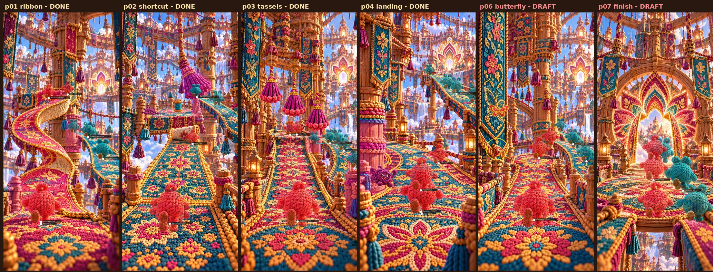

# Checkpoint — 2026-10-16 15:17 UTC

Work is paused for review. No agents are running and none will be launched until you say so.

## Where everything is saved

* `ccr-3132632e-hygdla` (this session's branch) holds all work, including the old session's final auto-save
  (`20a31a1`) and this checkpoint.
* `ccr-78a11afa-tcuf5u` (the previous session's branch) holds the same work up to `20a31a1`.

## Current game

The game does not run yet. `game/index.html` loads and shows the loading card, then stops at 0%. 12 of its scripts
(simulation, renderer, UI and `main.js`) were never written, so the browser gets 404s for them. No gameplay
recording exists because there is no gameplay yet.

The image above comes from the authoring tool (`tools/plate-overlay.py`), not from the game. It draws the authored routes and sprite
positions onto each plate. p01–p04 are finished; p06 and p07 are still rough drafts.

## Finished and working

| Piece | Status |
|---|---|
| Visual kit in `kit/` | All 4 parts are in. 17 files lost from the truncated Part 4 were rebuilt: 15 match their original SHA-256 exactly, 2 atlases were reassembled from exact frames, and 1 pose (Purl `run-pass-a`) came from the preview's WebP and is not byte-exact. The 7 approved PNGs match their hashes. Details: `kit/RECOVERY-REPORT.json`. |
| Runtime assets | `tools/build-runtime-assets.py` writes WebP plates/atlases (~7 MB) and `game/src/data/asset-data.js` with frame rectangles and foot pivots. |
| Core code | `game/src/core/ww.js` (tuning, seeded RNG, utilities) and `game/src/core/path.js` (route geometry). |
| Module contract | `docs/ARCHITECTURE.md` |
| Route data p01–p04 | Authored and checked against the approved shots (stops, pickups, lanes, tassels, Snagling hide/peek, occluders). |
| Level route | `game/src/data/level.js`: segment lengths and objectives are first drafts and have never been run. |
| Page shell and styles | `game/index.html` and `game/style.css` (HUD pills, rewards strip with cash out locked, start, pause, fail and results overlays). They have not been tested, because no script drives them yet. |
| Android host source | `android/` (WebView with asset loader, insets, pause on background, Back handling, no INTERNET permission), plus launcher icons and `tools/build-android.sh`. **It has never compiled.** |

## Still to implement

1. Route data for p06 (butterfly) and p07 (finish), currently drafts.
2. Simulation `game/src/sim/*.js`: race state, inventory and drops, stitches, Snagling, Loop AI, gate and results. Unit tests and pacing tuning.
3. Renderer `game/src/render/*.js`: camera, plates, route-opening animations, tassels, butterfly, characters, Snagling, spools, cues, transitions and occlusion.
4. UI scripts `game/src/ui/*.js` and `game/src/main.js`: HUD updates, touch input, overlays, game loop, pause and lifecycle.
5. Playwright touch tests, a full-run recording, dodge and hit/recovery recordings, and a comparison against the seven approved shots.
6. Android SDK install in this container, a dependency fix, the APK build, and the README.

## What blocks the first Android build

1. The game itself doesn't exist yet (items 2–4 above). The build script refuses to package an incomplete `game/`.
2. This container has no Android SDK. The SDK installed last session was in a container that no longer exists.
3. Gradle cannot download its dependencies. Today's check (`2026-10-16-gradle-check.log`) shows the Gradle
   distribution and Google's Maven repository downloading fine. Maven Central, however, answers
   **HTTP 429 Too Many Requests**, and 26 artifacts could not be resolved. A likely workaround is a public Maven
   Central mirror or slower serial fetching. It has not been tried.

## Agents

| Agent | State |
|---|---|
| p01/p02 route data, p03/p04 route data | Finished |
| Simulation, HUD/input/lifecycle, Android host | Stopped 15:10 UTC, usage limit ("resets 7pm UTC") |
| Renderer | Stopped 15:12 UTC, usage limit. It had not written any files. |
| p06/p07 route data | Silent since 15:03 UTC. It had not written any files. |

The old session's container auto-saved a history snapshot at 15:13 UTC. I can't reach that container from here,
so it may keep pushing history snapshots to `ccr-78a11afa-tcuf5u` until it shuts down. Nothing runs in this session.

## Measured usage

These token counts are summed from the exported transcripts of the previous session (main chat plus 9 agents). The
last minute or two before the export may be undercounted.

| | output | cache read | cache write | uncached input |
|---|---:|---:|---:|---:|
| Main chat | 153,593 | 18.4 M | 310 K | 158 |
| p01/p02 route data | 142,994 | 19.1 M | 282 K | 204 |
| p03/p04 route data | 132,508 | 13.9 M | 228 K | 156 |
| Renderer | 61,244 | 3.4 M | 144 K | 58 |
| Simulation (two tries) | 59,287 | 1.0 M | 208 K | 30 |
| HUD/input/lifecycle | 53,008 | 2.2 M | 111 K | 48 |
| Android host | 45,037 | 2.7 M | 96 K | 60 |
| p06/p07 route data (two tries) | 26,851 | 3.3 M | 179 K | 74 |
| **Total** | **674,522** | **64.0 M** | **1.56 M** | **788** |

* I don't have a dollar figure for the previous session.
* For this session, the platform's session record reports `cost_usd` 1.45 as of 15:14 UTC. That covers 8,005
  output tokens and 1.8 M cache reads, and it is not yet updated for the rest of this checkpoint.
* The session record shows the account's **seven-day usage limit at "allowed_warning"**, resetting
  2026-10-21 22:00 UTC. The previous session hit a separate session limit that resets at 19:00 UTC today.
